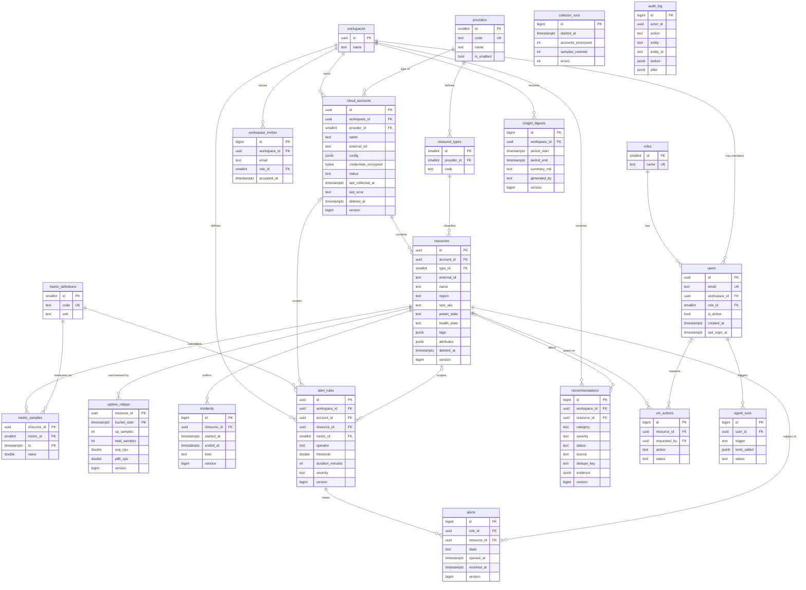

# ER diagram

Crow's-foot diagram (renders on GitHub). A Chen-notation version is in [SyncViewer_ER_Diagram.png](SyncViewer_ER_Diagram.png).

`audit_log` and `collector_runs` have no foreign keys by design: they must survive deletion of the rows they describe.

## Normalization (3NF)
- Every table has a single-attribute or minimal composite primary key; non-key columns depend on the whole key and nothing else.
- Roles, providers, resource types and metric definitions are separate lookup tables, so names/units are stored once (no transitive dependency such as `resource -> provider name`).
- Ownership is stored once, on `cloud_accounts.workspace_id`. Resources, alerts and incidents reach their owner through joins instead of duplicating `workspace_id` (which would create a transitive dependency).
- `uptime_rollups` is deliberately a derived (denormalized) summary table for read performance; it is regenerable from `metric_samples` by `compute_uptime_rollup`.
- JSONB columns (`tags`, `attributes`, `config`, `evidence`) hold provider-specific, schema-less data that is never joined or filtered relationally.
